## Hi, I'm Palani

I build products end to end: I sit with the people who will use the thing, work out what they need, then design it and ship it.

Final-year M.Tech (Computer Science) student at VIT Chennai. Based in Chennai, moving to Singapore in 2027.

### What I'm building

**[QMS Pro](https://qmsprolabs.com)** is quality management software for accredited calibration and testing labs (ISO/IEC 17025). It checks a lab's records and lists what an assessor would flag, each finding with its clause and its fix. I spent a year inside a calibration lab before writing it. It went live in November 2026 and the first lab is onboarding. Every release has to pass 7,240 automated tests. The code is private because it is a commercial product; the case study is on [palani.cloud](https://palani.cloud).

### Other work

- **Artha**: a research assistant for Indian equities that answers only from cited sources and says "I don't have that in the ingested data" when the evidence is missing. Next.js, FastAPI, LangGraph, pgvector, AWS.
- **Maths gap finder** (VIT Chennai research): traces a wrong answer back to the misconception behind it, using a prerequisite knowledge graph. Ranking quality (MAP@25) went from 0.326 to 0.465.
- **[RightNow India](https://github.com/palani1492/rightnow-india)** (OpenAI hackathon, [live demo](https://rightnow-india-eno1.vercel.app)): a prototype that finds public services by life event, with consent and review before any action.

### How I work

I run my own agentic coding setup, so most of my code is written by AI agents while I decide what to build, review it and test it. I care most about interfaces that people who dislike software can still use.

### Contact

[palani.cloud](https://palani.cloud) · [LinkedIn](https://linkedin.com/in/p4l4nix)
